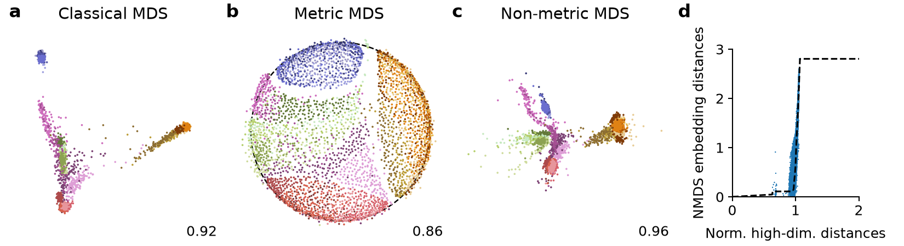

# Stochastic MDS and NMDS



Code for *Stochastic non-metric MDS for noisy high-dimensional data*.

* **To use our MDS in your own code**, see the next section: one file, no need for the rest of this repository.
* **To reproduce our experiments**, continue with "Setup for reproducing the experiments".

## Using the stochastic MDS in your own code

`code/stochastic_mds.py` is a single self-contained file (not a package; it imports nothing from the rest of
this repository). Copy it into your project and import the function:

```
pip install numpy scipy "scikit-learn>=1.8" torch     # its only dependencies; CPU-only PyTorch is enough
```

```python
from sklearn.datasets import load_digits
from scipy.spatial.distance import pdist, squareform
from stochastic_mds import stochasticMDS

X, y = load_digits(return_X_y=True)                    # data matrix, shape (1797, 64)

Z, stress_curve = stochasticMDS(X)                     # metric MDS
Z, stress_curve = stochasticMDS(X, non_metric=True)    # non-metric MDS: Z has shape (1797, 2)

# from an (n, n) distance matrix instead of a data matrix
D = squareform(pdist(X))
Z, _ = stochasticMDS(D, precomputed_distances=True, non_metric=True)

import matplotlib.pyplot as plt                        # optional
plt.scatter(Z[:, 0], Z[:, 1], c=y, cmap="tab10", s=3)
```

The three runs above take about 15 seconds on one CPU core (progress is printed every 10 epochs; pass `verbose=False` to silence it).
As a sanity check, the last entry of `stress_curve` on digits is about 0.33 for metric and 0.28 for non-metric MDS.

**Scale.** The distances are normalized in every mini-batch (mean squared off-diagonal value 1), so the defaults
work for any data scale. The returned embedding is on this normalized scale, not on the scale of the data, unlike
the output of scikit-learn's metric MDS.

## Setup for reproducing the experiments

```
uv sync                       # creates .venv (CPU-only PyTorch on Linux/Windows)
```

* Put the genomes and Tasic data into `data/` (see `data/README.md`); MNIST downloads itself.
* The figure notebooks use the matplotlib style in `code/mpl_style.txt`.

## Layout

```
code/
  README.md           notes: what counts as one run, metric definitions, extending, timing
  stochastic_mds.py   the algorithm (needs torch)
  methods.py          registry of embedding methods
  datasets.py         registry of datasets (+ per-dataset skips and settings)
  metrics.py          registry of evaluation metrics
  embed.py            stage 1: run methods, save embeddings and runtimes
  evaluate.py         stage 2: compute metrics for the saved embeddings
  collect.py          stage 3: join everything into results/all_runs.csv, report what is missing
  ablations.py        parameter grids (isotonic frequency, batch size, PCA before MDS, random init), same stages
  mds_robustness.py   separate from the pipeline: the noise-robustness simulation of metric vs non-metric MDS
  tables.py           print mean ± std tables to copy into the manuscript
  animations.py       GIFs of the optimization (SGD and SMACOF); smacof_trajectory.py records SMACOF
  display.py          names / row order / which method fills which table row
  plan.py, pipeline.py, results_io.py, paths.py    shared machinery
  notebooks/          figures only: they read saved results, they never compute embeddings
  tests/
results/              embeddings/ metrics/ ablations/ all_runs.csv environment.json
figures/
data/
```

## Running the experiments

```
uv run python code/embed.py                    # all datasets x methods x 3 seeds (slow; incremental)
uv run python code/evaluate.py                 # all metrics (fast)
uv run python code/collect.py                  # results/all_runs.csv + list of anything missing
uv run python code/tables.py stress            # also: runtime (every method), triplet_acc, knn_recall, pearson, ..., isotonic, pca;
                                               # `summary` = all metrics + runtime per method
uv run python code/tables.py stress --latex    # any table (except `summary`) as LaTeX rows for the manuscript, stds in \scriptsize
```

Everything takes `--datasets`, `--methods`, `--seeds` to restrict what runs, e.g.
`uv run python code/embed.py --datasets digits --methods tsne umap`.
Stages are incremental: finished work is skipped, so you can interrupt and resume. `embed.py --force`
recomputes. A crashing run is logged and skipped; `collect.py` tells you what is missing.

Ablations are kept apart from the main runs. Each uses three seeds, except the two batch-size ablations, which are
configured with one (`seeds` in its entry in `code/ablations.py`); `--seeds` overrides the configured seeds for `embed` and `evaluate`:

```
uv run python code/ablations.py embed          # also: evaluate, collect, status  (--ablations, --datasets, --seeds)
uv run python code/tables.py isotonic          # and: pca
```

Figures: open `code/notebooks/figures_embeddings.ipynb`, `figures_sgd_batch_size.ipynb` and `figures_supplement.ipynb`
(`uv run jupyter lab`; the last one needs `ablations.py embed/evaluate --ablations mmds_random_init`, see its first cell).
Tests: `uv run pytest`.

More details (what counts as one run, metric definitions, extending the code, timing) are in
[`code/README.md`](code/README.md).

### Robustness to high-dimensional noise

The simulation behind the figure `robustness` and its appendix is independent of everything above: three clusters
plus d noise dimensions, metric and non-metric MDS from a random initialization (and classical MDS = PCA as a deterministic
reference), and the d at which the kNN accuracy of the embedding collapses. `code/mds_robustness.py` runs it and saves `results/robustness/<setting>.npz`; the notebook
`code/notebooks/figures_robustness.ipynb` makes the figure and the slopes.

```
uv run python code/mds_robustness.py --jobs 8               # all six settings of the paper, 10 repetitions each
uv run python code/mds_robustness.py --reps 20 --jobs 8     # more repetitions (the saved ones are kept)
```

On one core the figure's setting takes about 20 minutes, each of the other settings with about 99 points 20 to 30 minutes, and
the setting with 297 points hours; `--jobs` runs the MDS fits in parallel. Single settings can be run by name (`CONFIGS` in the file).

## Animations of the optimization

GIFs of how our SGD and scikit-learn's SMACOF arrive at the embedding, e.g. for talks. They are separate from
the pipeline and not used in the paper.

```
uv run python code/animations.py compute                   # genomes, all four runs: results/animations/genomes_<run>.npz
uv run python code/animations.py render                    # figures/animations/genomes_<run>_dark.gif, one per run
uv run python code/animations.py compute --datasets tasic  # Tasic: the two SGD runs (no SMACOF, too slow there)
uv run python code/animations.py render --datasets tasic
```

Runs: `sgd_mmds`, `sgd_nmds` (our SGD, with the settings of the main runs and seed 0) and `smacof_mmds`,
`smacof_nmds` (scikit-learn's SMACOF, classical-MDS start); `--methods` picks some of them. `compute` skips
saved runs (`--force` recomputes), `render` only reads them. On one core, genomes takes about 6 minutes and the
Tasic metric run a few; non-metric SGD on Tasic (500 epochs) takes much longer.

Rendering options: `--light` (white background, `..._light.gif`), `--jumps` (no interpolation between saved
snapshots, so every SMACOF iteration is a jump; `..._jumps.gif`), `--lighten` (Tasic: lighter colours for the
non-neuronal cells, which are hard to see on a dark background; `..._lighter.gif`), `--size` (pixels, default 720), `--seconds`
(default 12, plus a short hold at the start and the end), `--fps` (default 15), `--tau` (see below).

What the GIFs show:

* Every frame is rescaled to unit RMS radius and centred on its (robust) bounding box, so only the shape is shown.
* Time is logarithmic, `log(1 + epoch / tau)` with `tau = 2` (`--tau 0`: linear), so the first epochs, where most
  of the change happens, get about a quarter of the animation.
* Top right: the epoch (SGD) or iteration (SMACOF). Bottom right: the stress-1 of the current embedding, evaluated
  as in `metrics.py` (not the batch averages of the optimizer).

How the trajectories are recorded: `stochasticMDS(..., snapshot_every=N)` also returns the embedding every N epochs
(or every N mini-batches with `snapshot_unit="batch"`), with the progress in epochs and the step size; taking
snapshots does not change the result. `code/smacof_trajectory.py` records every iteration of one ordinary
scikit-learn SMACOF run. (Running scikit-learn one iteration at a time, each starting from the previous result,
is exact for metric MDS but not for non-metric MDS: its first iteration skips the isotonic regression, so such a
chain converges to the metric solution.) Details are in the docstring of `animations.py`.
